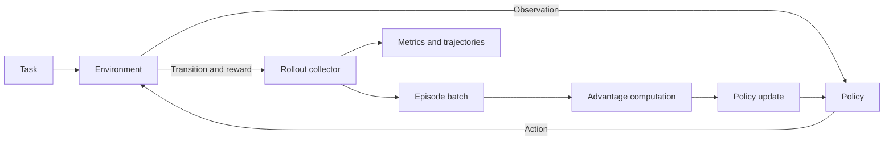

# Tool-routing task

## Interaction loop



`environment.py` defines the synthetic tasks and environment; `policy.py` defines
its tabular policy. `rollout.py` collects complete episodes for both training and
evaluation. `algorithms.py` computes advantages and updates the policy, and
`train.py` runs the experiment with a separate evaluation environment and generator.

## Environment contract

`ToolRoutingEnv.reset(task)` returns an `Observation`. `step(action)` returns a
`StepResult` with the next observation, reward, and three flags:

| Flag | Meaning |
| --- | --- |
| `terminated` | The agent submitted an answer, correct or incorrect |
| `truncated` | The step budget ran out before an answer was submitted |
| `success` | A submitted answer exactly matched the task's expected answer |

An answer on the last permitted step is a termination, not a truncation. Calling
`step` before reset or after either ending raises an error. All three actions are
legal at every active state; premature answers can fail. The default maximum is
four actions, including tool calls and answer submission.

| Action | Effect | Reward |
| --- | --- | --- |
| `calculator` | Add the task's supplied integer operands, if present | `-tool_cost` |
| `lookup` | Read the task's supplied key from the synthetic local table, if present | `-tool_cost` |
| `answer` | Submit the current evidence verbatim | `1` if correct, otherwise `0` |

A mismatched tool reports an error and preserves any previous evidence. A tool
call on the final step still incurs its cost and then truncates the episode.
No extra reward is awarded for obtaining evidence: the agent must submit it.
At the default cost of 0.05, the oracle's two-action trajectory returns 0.95.

The calculator directly adds integers; it does not evaluate arbitrary code.
The lookup tool uses a small project-authored table, with no network access.

## Observation and state abstraction

The full observation has the prompt, task kind, current tool evidence, last tool
message, and remaining steps. The tabular policy uses only a state index encoding:

```text
state_id = ((task_kind * 2) + evidence_available) * (max_steps + 1) + steps_remaining
```

There are `2 * 2 * (max_steps + 1)` possible indices, including terminal states.
With a four-step budget the policy has 20 rows and three logits per row.

The expected answer belongs to `Task`, which is passed to the environment and
verifier. It is never passed to the policy. Tool evidence naturally reveals an
answer after a successful call. Structured task kind and tool arguments are
intentional simplifications: the policy does not need to infer them from text.

## Data and randomness

`make_tasks` alternates arithmetic and lookup tasks for a balanced task pool.
Training uses operands 1–20 and six lookup keys; evaluation uses operands 21–40
and the other six keys. A seed regenerates the same pool. Pool sizes count prompts;
prompt contents can repeat, especially in the deliberately small lookup table.

Each training iteration samples task indices with replacement. For each sampled
task, `group_size` independent episodes are collected before updating. GRPO computes
advantages within those same-task groups. REINFORCE uses reward-to-go per step.

The experiment seed spawns separate task-generation and training-rollout generators.
Evaluation uses `seed + 100000` to generate its own tasks and a fresh rollout
generator, without consuming training randomness. The evaluation rollout generator
is reset on each call, making evaluation cadence independent of training samples.

## Persistence

The final checkpoint contains logits, a format version, and serialized effective
configuration. Loading disables pickle and validates the logit shape and values.
Evaluation uses the stored environment settings, including tool cost and step limit.

`metadata.json` records Python and NumPy versions, platform, Git revision when
available, and a SHA-256 fingerprint of the repository-root Python source files. The fingerprint distinguishes local source edits even before a commit.
For reproducibility, retain the corresponding sources or commit them: a hash alone
cannot reconstruct code. Configurations are stored separately as complete JSON.

The checkpoint does not store the baseline, RNG state, or training iterator, so it
is an inference/evaluation artifact rather than a training-resume snapshot.

## Scope and limitations

- Tools solve the underlying arithmetic and lookup problems. The learned policy
  controls tool routing and stopping, using a supplied task-kind feature.
- Held-out prompt contents share exactly the same state representation and tool
  semantics as training. Results measure this control task, not open-ended
  generalization or language reasoning.
- The task has short episodes, deterministic tools, and a small action space.
  There is no argument generation, external retrieval, learned memory, or sandbox.
- The GRPO implementation is an action-level educational variant without a
  reference model or KL penalty. There is no LLM, tokenizer, neural policy, or
  distributed backend. See [algorithm details](algorithms.md).

